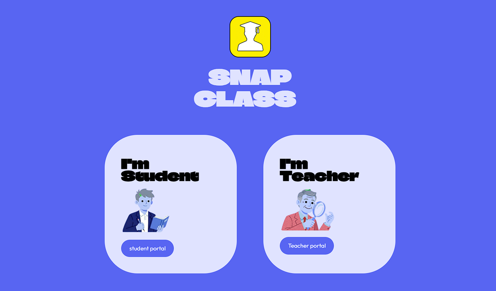

# 🌐 SnapClass – Landing Page

> The official landing page for **SnapClass**, an AI attendance system that uses face recognition + voice verification. Take attendance in one snap.

🔗 **Live Site:** <https://snapclass-landing-page-zeta.vercel.app/>
🚀 **Live App:** <https://snapclass-smart-ai.streamlit.app/>
📦 **Main Project Repo:** [snapclass-ai-attendance](https://github.com/vishu56096-ctrl/SnapClass-AI-Attendance)

---

## ✨ Sections

- **Home**: hero with headline, call-to-action buttons, and stats
- **Features**: FaceID login, classroom photo attendance, voice attendance, subject codes, attendance records, student dashboard
- **Journey**: step-by-step flow for both **Teacher** and **Student** (switch with a toggle)
- **Tech Stack**: tools used, plus the AI pipeline diagram
- **CTA + Footer**: "Start AI Attendance" button and links

---

## 🎨 Design Highlights

- Bold display headings with a clean off-white background
- Black navbar with a yellow logo accent and white pill CTA button
- Alternating text / figure layout in rounded lavender cards
- Smooth scrolling, scroll-reveal animations, and hover effects
- Fully responsive (mobile, tablet, desktop)

---

## 🚀 Deployment

You can host this site for free on:
- **GitHub Pages**: Settings → Pages → select `main` branch
- **Netlify** or **Vercel**: drag and drop the folder or connect the repo

---

## 📸 Preview

---

## 👤 Author

**Vishal Kumar**
- GitHub: [vishu56096-ctrl](https://github.com/vishu56096-ctrl)
- LinkedIn: <https://www.linkedin.com/in/vishal-kumar-7a4003393/?isSelfProfile=true>

---

⭐ If you like this project, give it a star!